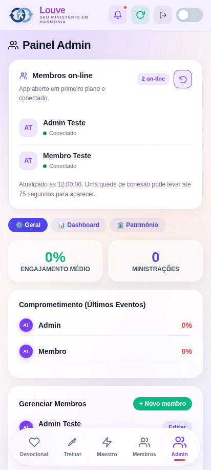
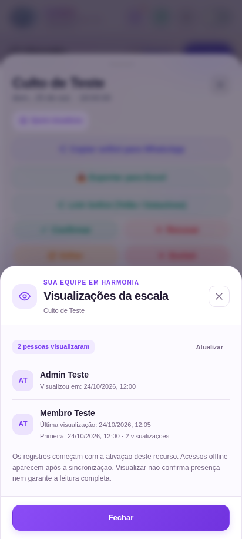
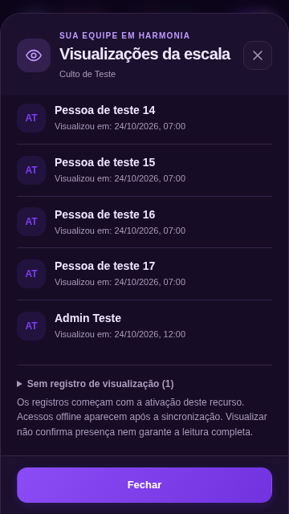

# Membros on-line e visualizações

O admin encontra **Membros on-line** na aba Admin. Nos detalhes de cada escala e em cada aviso do mural, **Quem visualizou** abre a lista com nome, primeira/última visualização e quantidade de acessos. A lista **Sem registro de visualização** indica ausência de um registro, não uma confirmação de que a pessoa nunca viu o conteúdo.

Cada relatório pertence ao ID daquele evento ou aviso. Eventos com o mesmo nome têm históricos independentes; a data e o horário do evento aparecem no painel para distinguir escalas recorrentes. O total de pessoas conta cada membro uma vez naquele conteúdo; a quantidade de visualizações na linha do membro conta suas aberturas daquele mesmo conteúdo. Ao trocar de evento, o painel aguarda a nova consulta sem reaproveitar nomes, contagens ou horários do relatório anterior. Essa correção é da aplicação e não requer executar novamente o SQL.

## Ativação no Supabase

A implementação precisa de duas tabelas novas e uma função RPC. O arquivo é separado da aplicação e não é executado pelo build ou pelo deploy da Vercel:

1. No projeto Supabase já usado pelo LouveSync, abra **SQL Editor → New query**.
2. Copie todo o conteúdo de [20261108_admin_activity.sql](../supabase/migrations/20261108_admin_activity.sql) e execute como administrador do projeto.
3. Aguarde o deploy do código na Vercel e reabra o app nos aparelhos. Entre com os membros e PINs existentes.

O SQL cria somente `louvesync_activity_sessions`, `louvesync_content_views`, seus índices e a função `louvesync_activity`. Pode ser executado novamente e preserva os registros existentes. Inclui a atualização do cache de esquema do PostgREST. Não altera membros, músicas, eventos, avisos, confirmações ou o login.

A API `/api/activity` reutiliza `VITE_SUPABASE_URL` e `VITE_SUPABASE_ANON_KEY` da Vercel (ou os equivalentes `SUPABASE_URL` e `SUPABASE_ANON_KEY`). Não precisa de uma chave de serviço nova. Se o SQL ou a configuração ainda não existir, o painel mostra a indisponibilidade; não informa falsamente que todos estão offline ou sem visualizações.

Se aparecer erro de configuração do servidor após alterar as variáveis, confira essas duas configurações em **Settings → Environment Variables → Production** e faça **Redeploy**. Elas precisam estar disponíveis para as funções da API, além do build do site. As variáveis VAPID e `SUPABASE_SERVICE_ROLE_KEY` das notificações são adicionais e não substituem a URL e a chave pública. Nunca coloque a chave `service_role` em `VITE_SUPABASE_ANON_KEY`. A API identifica no erro qual configuração está faltando; não é necessário reinstalar o SQL nem apagar o histórico para corrigir esse caso.

## Regras de registro

- On-line significa app em primeiro plano e conectado. Cada aparelho tem sua própria sessão e envia um sinal a cada 25 segundos. Minimizar, sair ou fechar tenta encerrar a sessão imediatamente. Sem esse sinal, ela expira após 75 segundos. Uma pessoa em dois aparelhos aparece uma vez; fechar um deles não desconecta o outro. Versões de sessão impedem que um sinal atrasado ressuscite uma sessão encerrada.
- A escala é registrada ao abrir seus detalhes. Isso não confirma presença e não altera o setlist.
- Um aviso conta após uma porção relevante do card ficar visível por um segundo no mural. Cards fora da área visível, atrás de um formulário ou em segundo plano não contam. A permanência no mesmo card não gera novos registros; voltar ao mural ou reabrir a escala pode gerar outra visualização.
- Cada observação tem um UUID. Se a rede falhar, o app guarda o registro no aparelho e repete o envio com o mesmo UUID, sem duplicar a contagem. As filas de membros diferentes são separadas e o envio exige a sessão atual do próprio membro. PINs não são incluídos na fila.
- `viewed_at` guarda o horário de observação do aparelho; `received_at` guarda o recebimento pelo servidor. Isso preserva o horário de uma visualização offline, sujeito à precisão do relógio do dispositivo.
- O histórico não é retroativo. Aparelhos com versões antigas não enviam os novos registros. Visualização não comprova leitura ou compreensão do aviso.

Os relatórios recebem invalidações pelo canal Realtime já existente e são consultados novamente automaticamente a cada 15 segundos enquanto estão abertos. Apenas um aviso de atualização é transmitido; nomes e horários são consultados pela API.

## Acesso e limites do login atual

As tabelas novas têm RLS e não permitem leitura/gravação direta pelos papéis de banco `anon` ou `authenticated`. A função confere o PIN existente e consulta `members.is_admin` no banco para liberar os relatórios. Um sinalizador de admin enviado pelo cliente é ignorado.

O login por PIN foi mantido conforme o escopo. O aplicativo legado carrega os PINs com a lista de membros para validar o login no cliente; isso limita a proteção contra personificação. Esta implementação não transforma esse modelo em autenticação forte. Retirar os PINs das respostas públicas e migrar a autenticação exigiria uma alteração separada do login.

## Validação

`npm test` verifica a API, a fila offline, a separação entre membros e a proteção de credenciais. `npm run test:activity:sql` usa um PostgreSQL 17 descartável em Docker, sem rede e sem acesso a produção, para verificar permissões reais, instalação repetida, histórico, idempotência, expiração e múltiplos aparelhos. `npm run test:e2e` verifica os painéis em sessões independentes do navegador.

Após a instalação em produção, confira com dois membros: admin em um aparelho, membro comum em outro; abra os detalhes da escala e um aviso no mural, veja nomes e horários no admin e minimize o segundo app. Esses testes locais não substituem a confirmação no Supabase de produção ou em dispositivos físicos.

## Capturas com dados de teste

| Membros on-line | Visualizações de uma escala |
| --- | --- |
|  |  |

