# Interface do LouveSync

Capturas do aplicativo em Chromium, com dados de demonstração e sem acesso ao banco de produção.

A janela principal usa a altura de layout por CSS: `100dvh` no navegador e `100lvh` (com fallback para `100vh`) no app instalado. Uma altura menor de `visualViewport` sem teclado não limita o app. A altura visual só é usada quando há edição de texto e uma redução compatível com o teclado; página e diálogos compartilham o mesmo ajuste, que é liberado ao sair do campo ou fechar o teclado. Retorno ao app, rotação e zoom também são considerados.

Cabeçalho, fundo do documento e cor do navegador acompanham o tema salvo; o cabeçalho é opaco. O menu flutuante fica acima da área de gestos (ou a 8 px da borda quando não há essa área), e a rolagem reserva uma única vez sua altura medida mais 12 px de separação. As páginas não repetem essa reserva e a cifra usa somente o espaço inferior de leitura quando o menu está oculto.

As regressões usam Chromium com áreas seguras de iPhone simuladas (47 px no topo e 34 px embaixo), nos dois temas, além de desktop. O caso que antes deixava a tela em 797 px apesar de haver 844 px de layout foi reproduzido como teste antes da correção e agora também verifica a altura dos diálogos e o retorno ao app. São medidas controladas no teste, não medidas capturadas de um iPhone; a confirmação no aparelho físico continua necessária.

| Reprodução antes: app limitado a 797 px | Depois: app usa os 844 px do layout |
| --- | --- |
| 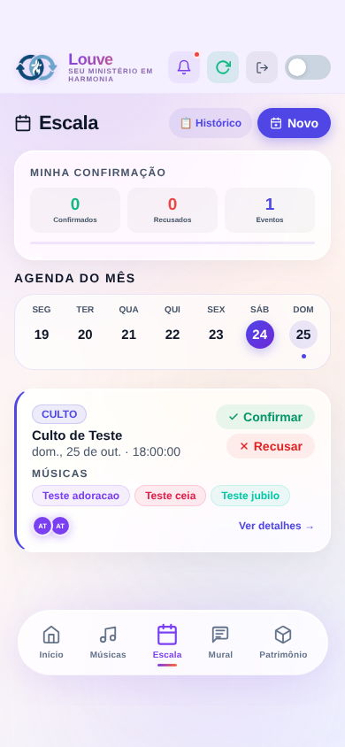 | 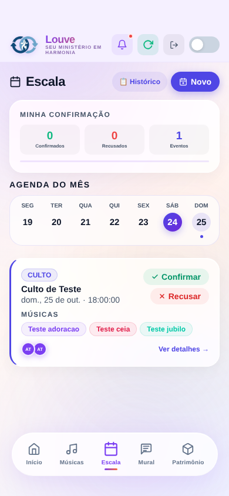 |

O editor mantém cabeçalho e ações visíveis durante a rolagem e oferece espaço dedicado para o setlist. Os mesmos campos e botões são usados em Bíblia, Ensaio e cifra.

O catálogo do evento agrupa músicas por categoria, com cores e contagem de selecionadas. O cadastro de membro usa um painel acima da página, com uma área de rolagem e ações fixas; as capturas mostram a parte superior e o final do formulário em uma janela de 320 px de largura. Os testes também verificam uma altura reduzida de 420 px, falha de gravação com preservação dos campos e nova tentativa de salvamento.

| Categorias do evento | Novo membro |
| --- | --- |
| 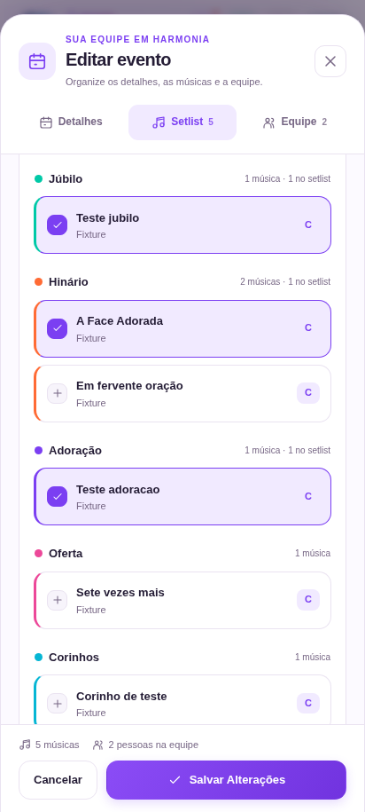 | 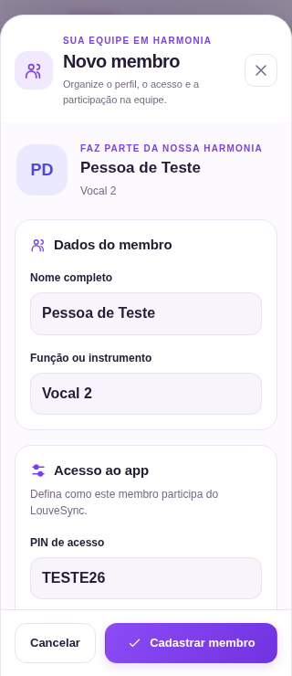 |

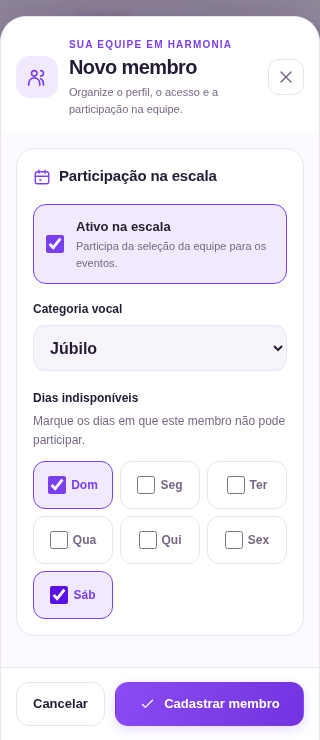

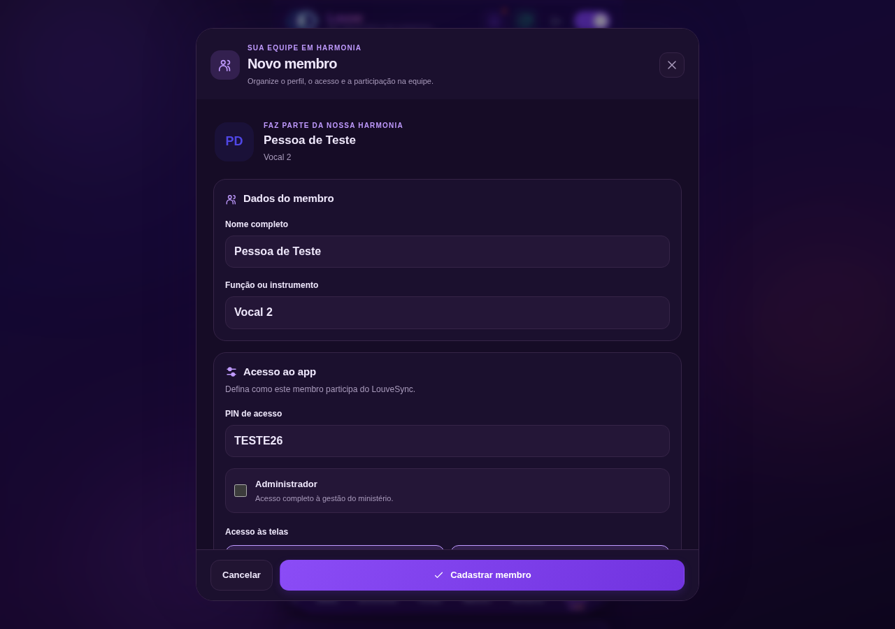

| Editor no celular | Setlist |
| --- | --- |
| 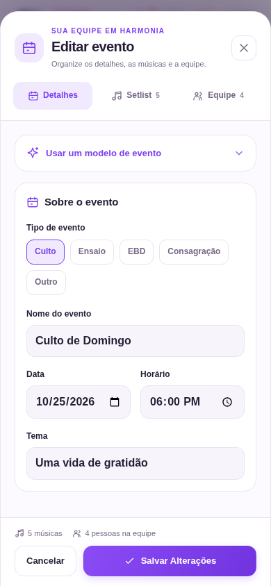 | 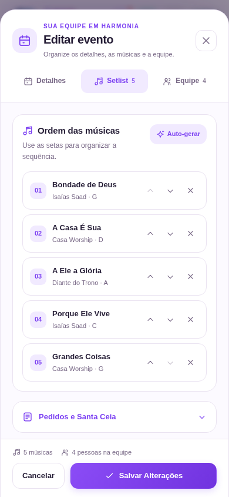 |

| Bíblia | Ensaio |
| --- | --- |
| 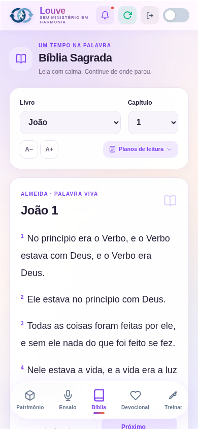 | 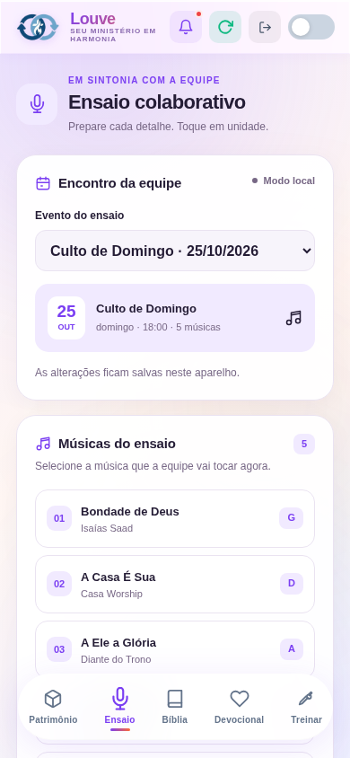 |

| Estilo e alertas | Cifra e tom por vocal |
| --- | --- |
| 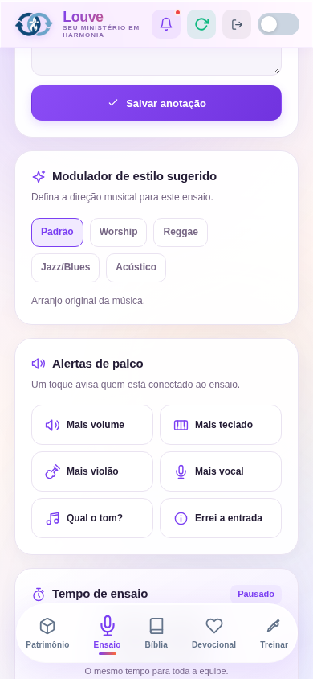 | 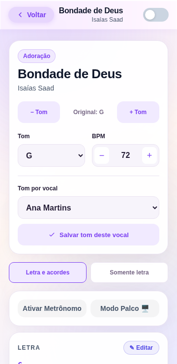 |

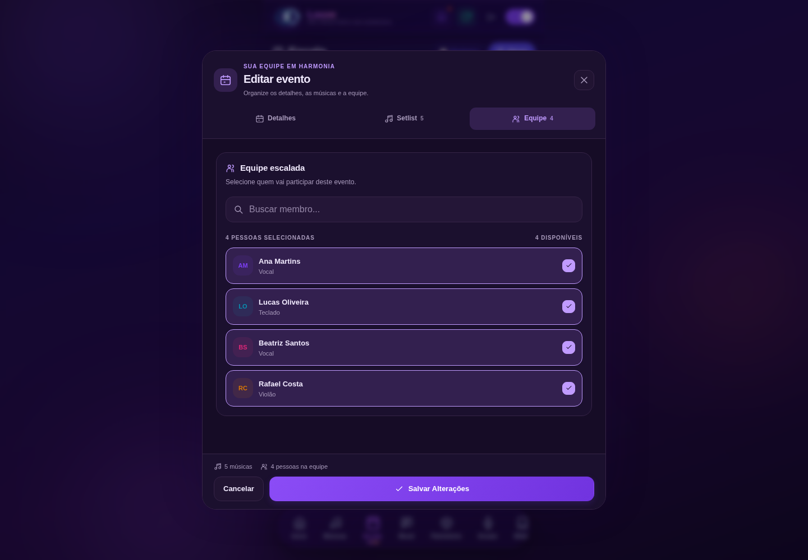
