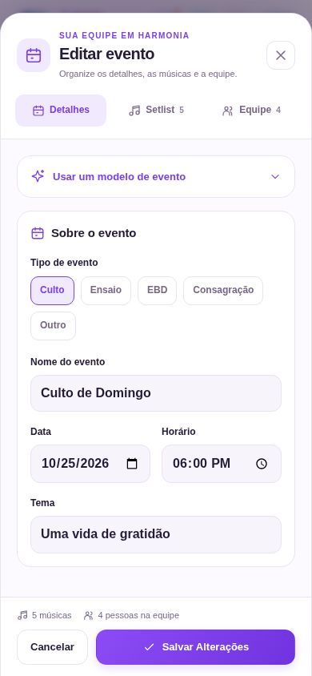
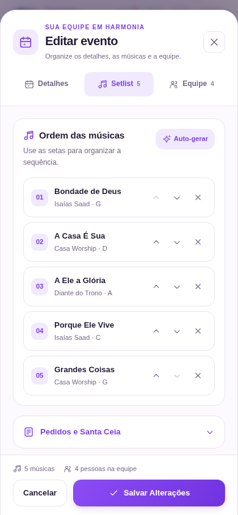
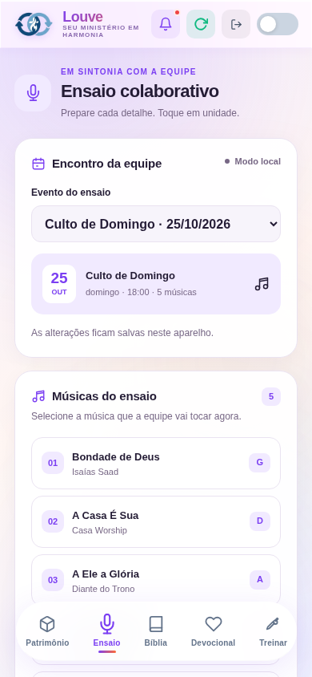
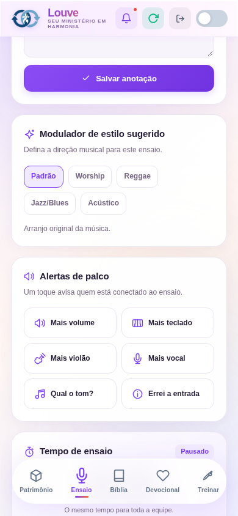
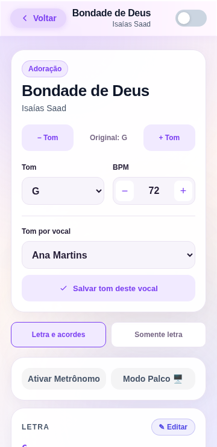
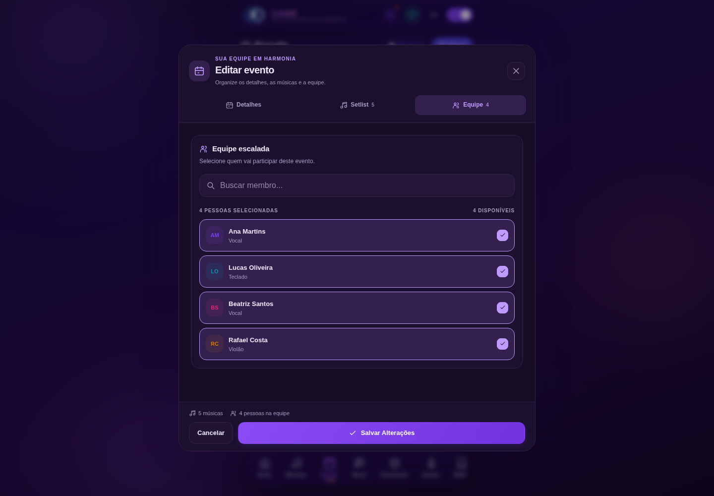

# Interface do LouveSync

Capturas do aplicativo em Chromium, com dados de demonstração e sem acesso ao banco de produção.

O editor mantém cabeçalho e ações visíveis durante a rolagem e oferece espaço dedicado para o setlist. Os mesmos campos e botões são usados em Bíblia, Ensaio e cifra.

| Editor no celular | Setlist |
| --- | --- |
|  |  |

| Bíblia | Ensaio |
| --- | --- |
|  |  |

| Estilo e alertas | Cifra e tom por vocal |
| --- | --- |
|  |  |

